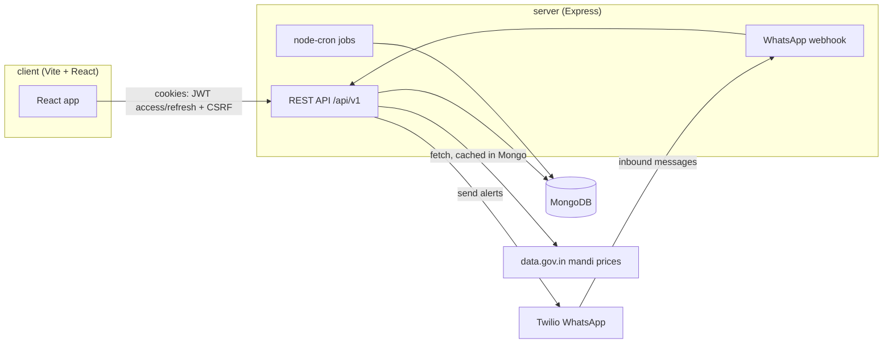

# FarmFair

**Know the real price. Sell at a fair price.**

Fair price discovery and a trusted marketplace for Tamil Nadu farmers and crop
buyers. Farmers see today's official mandi rates, list their crop, compare
openly-labelled offers, and get paid through escrow.

> **Status: Phases 1-7 complete** — foundation/security/auth, mandi prices,
> the marketplace, escrow orders, notifications and scheduled jobs, a
> WhatsApp bot for farmers, and an admin panel (buyer verification, user
> suspension, job monitor, bot message log). Phase 8 (seed/demo data,
> deployment config, this documentation) is in progress.

## Features

- **Fair price discovery** — daily mandi (wholesale market) rates per crop,
  district and market, with a day-over-day trend and a "check my price"
  fairness verdict against today's rate.
- **Marketplace** — farmers list graded crop with photos; buyers browse,
  filter and make offers that show how the offer compares to today's mandi
  price.
- **Escrow orders** — accepting an offer forms an order; payment is held
  (simulated provider) until both farmer and buyer confirm pickup, then both
  sides rate each other.
- **Notifications** — in-app and WhatsApp alerts for offers, orders and
  day-over-day price moves, backed by scheduled jobs (listing expiry, price
  alerts, data cleanup).
- **WhatsApp bot** — a bilingual (English/Tamil) command bot so a farmer
  without the web app can check prices, list a crop, and manage offers and
  orders over WhatsApp. See [`docs/WHATSAPP.md`](docs/WHATSAPP.md).
- **Admin panel** — buyer verification queue, suspend/unsuspend accounts,
  trigger and monitor scheduled jobs, inspect recent WhatsApp bot messages.

## Architecture



## Stack

| Layer    | Technology                                                                              |
| -------- | --------------------------------------------------------------------------------------- |
| Client   | Vite, React 18, TypeScript, Tailwind, shadcn/ui, TanStack Query, Zustand, react-i18next |
| Server   | Node 20, Express, TypeScript, Mongoose, Zod, Pino, argon2, JWT                          |
| Database | MongoDB 7 (single-node replica set, for transactions in Phase 4)                        |
| Tests    | Jest + Supertest + mongodb-memory-server (server), Vitest + Testing Library (client)    |

Three npm workspaces — `shared/` (Zod schemas, constants, types shared by both
sides), `server/`, `client/` — so validation rules cannot drift between the
client and the API.

## Getting started

Requires Node 20 (`.nvmrc`) and Docker.

```bash
# 1. install
npm install

# 2. start MongoDB (and mongo-express on http://localhost:8081, admin/admin)
docker compose up -d

# 3. configure the server
cp server/.env.example server/.env
# generate the two JWT secrets (must be at least 32 chars and must differ):
node -e "console.log(require('crypto').randomBytes(48).toString('hex'))"

# 4. run both apps
npm run dev
```

- Client: http://localhost:5173
- API: http://localhost:4000/api/v1
- API docs (development only): http://localhost:4000/api/docs
- Health: http://localhost:4000/api/v1/health

The server **refuses to start** on invalid configuration and prints exactly
which variables are wrong.

### Create an administrator

Admin accounts cannot be created through the public API. Use the CLI:

```bash
npm run create-admin
```

### Seed demo data

```bash
npm run seed         # 1 admin, farmers, buyers, prices, listings, offers, orders, ratings
npm run demo:reset   # wipe and reseed
```

Refuses to run in production unless `--force` is passed, and prints a
credentials table (phone numbers + passwords) for every seeded account at
the end so you can sign in and explore the app without registering manually.

## Scripts

| Script                  | What it does                                                            |
| ----------------------- | ----------------------------------------------------------------------- |
| `npm run dev`           | Builds `shared`, then runs the server and client together               |
| `npm run build`         | Builds all three workspaces                                             |
| `npm run typecheck`     | `tsc --noEmit` across all workspaces                                    |
| `npm run lint`          | ESLint (typescript-eslint, react, react-hooks, jsx-a11y)                |
| `npm run lint:fix`      | ESLint with `--fix`                                                     |
| `npm test`              | Full test suite (shared, server, client)                                |
| `npm run format`        | Prettier write                                                          |
| `npm run format:check`  | Prettier check (used in CI)                                             |
| `npm run create-admin`  | Interactive admin creation                                              |
| `npm run seed`          | Seed demo data                                                          |
| `npm run demo:reset`    | Wipe and reseed demo data                                               |
| `npm run job -- <name>` | Run one scheduled job once (`expireListings`, `priceAlerts`, `cleanup`) |

Server-only: `npm run test:coverage -w server` for a coverage report.

A Husky pre-commit hook runs lint-staged (ESLint `--fix` + Prettier) on staged
files. GitHub Actions runs install, lint, typecheck, test and build on every
push and pull request.

## Environment variables

See [`server/.env.example`](server/.env.example) for the full annotated
list. Core/required:

| Variable             | Notes                                                     |
| -------------------- | --------------------------------------------------------- |
| `NODE_ENV`           | `development` \| `test` \| `production`                   |
| `PORT`               | Default `4000`                                            |
| `MONGODB_URI`        | Must be a `mongodb://` or `mongodb+srv://` URI            |
| `CLIENT_URL`         | The only allowed CORS origin; must be https in production |
| `JWT_ACCESS_SECRET`  | ≥ 32 characters                                           |
| `JWT_REFRESH_SECRET` | ≥ 32 characters, must differ from the access secret       |
| `COOKIE_DOMAIN`      | Blank for localhost; parent domain in production          |

Optional, grouped by the phase that introduced them:

| Variable                                                                                              | Default                   | Purpose                                                                                                            |
| ----------------------------------------------------------------------------------------------------- | ------------------------- | ------------------------------------------------------------------------------------------------------------------ |
| `LOG_LEVEL`                                                                                           | `info`                    | Pino log level                                                                                                     |
| `RATE_LIMIT_WINDOW_MINUTES` / `RATE_LIMIT_AUTH_MAX` / `RATE_LIMIT_GENERAL_MAX` / `RATE_LIMIT_OTP_MAX` | 15 / 10 / 300 / 3         | Rate limit windows and caps                                                                                        |
| `TRUST_PROXY`                                                                                         | `false`                   | Enable only behind a proxy you control (Render, Nginx)                                                             |
| `OTP_PROVIDER`                                                                                        | `console`                 | `console` (logs the code) or `twilio`                                                                              |
| `DATA_GOV_API_KEY` / `DATA_GOV_STATE`                                                                 | unset / `Tamil Nadu`      | data.gov.in mandi price key; see [`docs/PRICES.md`](docs/PRICES.md)                                                |
| `STORAGE_PROVIDER` / `UPLOAD_DIR` / `LISTING_EXPIRY_DAYS`                                             | `local` / `uploads` / `7` | Listing photo storage and expiry                                                                                   |
| `PAYMENT_PROVIDER` / `RAZORPAY_*` / `COMMISSION_PERCENT`                                              | `simulated` / unset / `1` | Escrow payment provider (Razorpay is a named option only; not implemented — see Known limitations)                 |
| `NOTIFY_PROVIDER` / `TWILIO_ACCOUNT_SID` / `TWILIO_AUTH_TOKEN` / `TWILIO_WHATSAPP_FROM`               | `console`                 | WhatsApp notification delivery; see [`docs/WHATSAPP.md`](docs/WHATSAPP.md)                                         |
| `TELEGRAM_BOT_TOKEN`                                                                                  | unset                     | Reserved; no Telegram provider is implemented                                                                      |
| `JOBS_ENABLED`                                                                                        | `false`                   | Starts the cron schedule for `expireListings` / `priceAlerts` / `cleanup`. Enable on exactly one running instance. |
| `PRICE_ALERT_THRESHOLD`                                                                               | `10`                      | % day-over-day move that triggers a price alert                                                                    |
| `PUBLIC_BASE_URL`                                                                                     | unset                     | Public URL Twilio posts webhooks to; see [`docs/WHATSAPP.md`](docs/WHATSAPP.md)                                    |
| `SENTRY_DSN`                                                                                          | unset                     | Error tracking; disabled when empty                                                                                |

## Security

- Passwords hashed with **argon2id** (19 MiB, 2 passes), never logged
- Access token 15 min, refresh token 7 days, both **httpOnly / SameSite=strict**,
  Secure in production; the refresh cookie is scoped to `/api/v1/auth`
- `tokenVersion` revocation: logout, password change or suspension invalidates
  every token already issued
- Account lockout: 15 minutes after 5 failed sign-ins; login errors are
  deliberately generic to prevent user enumeration
- Double-submit **CSRF** tokens on all state-changing requests
- Helmet with a strict CSP (no `unsafe-inline` scripts), HSTS in production
- Rate limits: auth 10 / 15 min per IP, OTP 3 / 15 min per phone, API 300 / 15 min
- `express-mongo-sanitize` + `hpp` + 100 kb body cap; Zod strips unknown fields
- Phone numbers masked in logs and the audit trail; tokens and passwords redacted
- Audit log for register, login success/failure, lockout, logout, password change

## Testing

```bash
npm test                        # shared + server + client
npm run test:coverage -w server # server coverage report
```

Server tests use Jest + Supertest against `mongodb-memory-server` (no real
database needed). Client tests use Vitest + Testing Library.

## Documentation

- [`docs/API.md`](docs/API.md) — auth flow, error format, link to the live
  Swagger docs
- [`docs/PRICES.md`](docs/PRICES.md) — mandi price data source and fallback
- [`docs/WHATSAPP.md`](docs/WHATSAPP.md) — Twilio sandbox setup, webhooks,
  going to production
- [`docs/DEPLOYMENT.md`](docs/DEPLOYMENT.md) — MongoDB Atlas, Render, Vercel
- [`docs/USER_GUIDE.md`](docs/USER_GUIDE.md) — guide for farmers and buyers
  (English + Tamil)

## Known limitations

- **Orders/escrow** is simplified: no dispute flow or admin dispute
  resolution, no pickup weight/scale-photo capture, no transaction ledger
  collection, no Razorpay integration (payment is a simulated provider
  only), no auto-cancel/auto-release timers. Commission is a flat
  `COMMISSION_PERCENT`.
- **Notifications** are in-app and WhatsApp only; `TELEGRAM_BOT_TOKEN` is a
  reserved env var with no provider behind it.
- **Mandi prices** are fetched and cached lazily per district/day on first
  request, not imported on a schedule — see [`docs/PRICES.md`](docs/PRICES.md).
- No end-to-end (Playwright) test suite yet; coverage is unit/integration
  only (Jest/Supertest on the server, Vitest/Testing Library on the client).
- No production error tracking wired up yet beyond the reserved
  `SENTRY_DSN` env var.

Suggested next improvements: real logistics/pickup integration, voice
messages for the WhatsApp bot (many farmers prefer voice over text), and a
price-prediction model on top of the existing mandi price history.

## Licence

MIT
